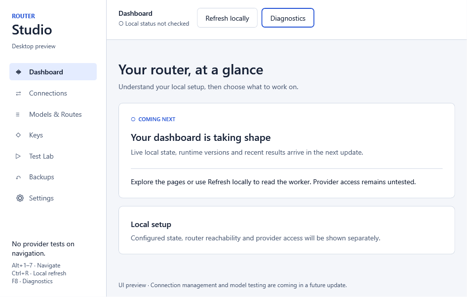
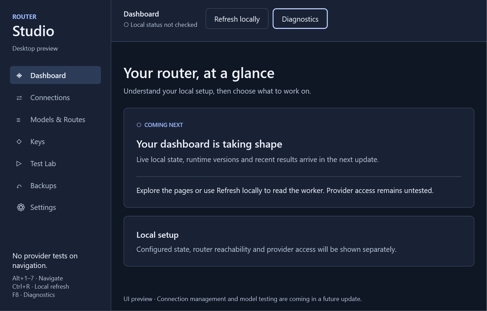
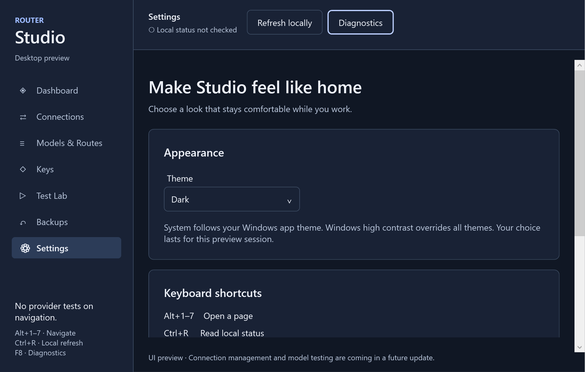
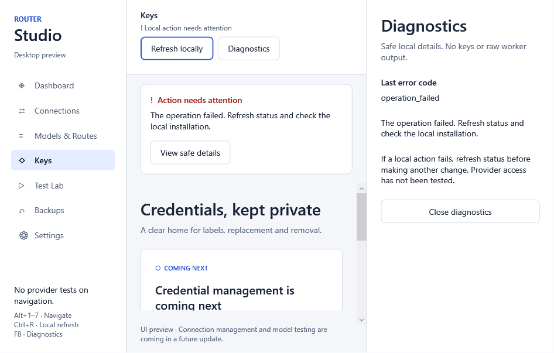
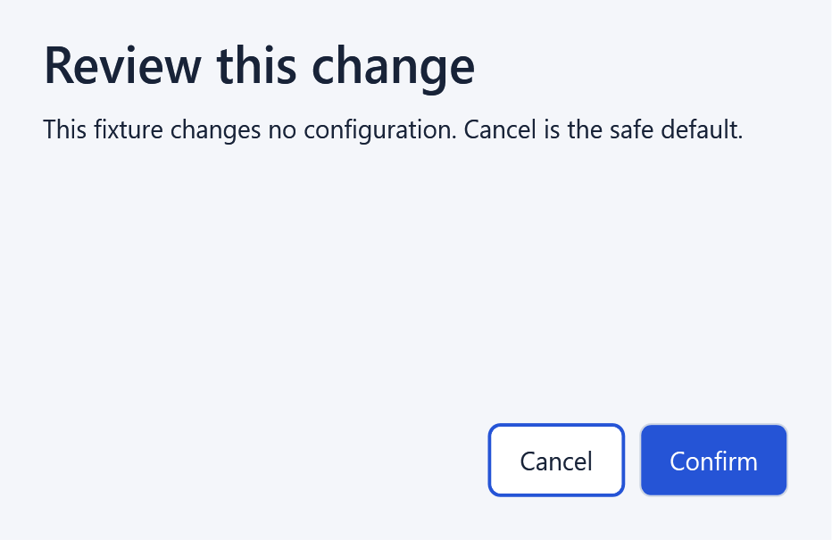

# Desktop acceptance — Task 4

Date: 2026-10-06. Scope: native WPF shell preview on the current Windows account.

## Evidence

The compiled native window was shown at 960 × 640 minimum size. A separate WPF acceptance executable uses an in-memory backend fixture; it does not access installed configuration, credentials or upstream providers. UI Automation invokes buttons; WPF native focus/traversal and bindings are exercised. A separate smoke check launches the actual desktop entry point against an empty fixture root and closes its owned window normally.

| Check | Result |
| --- | --- |
| Seven destinations render; all navigation items fit at minimum height | PASS |
| Navigation causes no backend actions or provider requests | PASS |
| Theme selection and dark window/background/text/selector contrast | PASS |
| Windows system-color high contrast palette resolves | PASS (palette simulation) |
| Loading blocks conflicting refresh; navigation remains usable | PASS |
| Error releases busy state, exposes safe text, opens/closes diagnostics; drawer reflows so keyboard focus remains visible | PASS |
| Settings scrolling reaches bottom | PASS |
| Programmatic native keyboard focus and traversal; shortcut bindings | PASS |
| Confirmation focuses Cancel, defaults to Cancel; explicit confirm/cancel invokes | PASS |
| Runtime binding errors | PASS (none observed) |
| Actual application startup, native window, normal exit | PASS (empty root fixture) |
| Physical OS display scaling at 100%, 150%, 200% | PENDING |
| Human keyboard, screen reader and real Windows high contrast/theme changes | PENDING |
| Separate isolated Windows account | PENDING — account unavailable per user |
| Public installer / daily-use feature journeys | NOT IMPLEMENTED — later tasks |

The fixture currently records 35 assertions plus the entry-point smoke check. RenderTargetBitmap outputs at 96, 144 and 192 DPI were visually inspected. These image resolutions do not prove an OS display scaling or screen-reader check.

## Screenshots







Additional loading, cancel and high contrast palette screenshots are in images/desktop/task4. The screenshot renderer includes the native content and theme background, not Windows title-bar chrome.

## Re-run

From PowerShell 7 in the project folder:

```powershell
$env:DOTNET_CLI_HOME = Join-Path (Get-Location) '.tools/cli-home'
& '.\.tools\dotnet\dotnet.exe' build '.\RouterStudio.slnx' -p:RestoreLockedMode=true
& '.\tests\desktop-acceptance.ps1' -NoBuild
& '.\scripts\Verify-Desktop.ps1'
```

The verifier builds the native acceptance project with locked restore before running it when the desktop project exists. SkipIntegration explicitly skips native, DPAPI and worker integration; it must not be reported as full acceptance. Native tests require an interactive Windows desktop. The test-owned windows close after the checks.

## Remaining manual checklist

On a separate test Windows account when available: launch the preview; navigate all pages with keyboard only; test Tab, arrow keys, Alt+1–7, Ctrl+R, F8 and Escape. Change physical display scaling to 100%, 150%, 200%, check minimum size and scrolling, and verify dialogs never hide their actions. Enable Windows high contrast and switch Windows light/dark app theme while the preview is open. Confirm accessible names and error announcements with a screen reader. Do not mark these checks passed based on rendered images alone.

## Task 5 acceptance

Task5 extends the same native fixture with dashboard snapshot binding, unverified authentication, actual15-second timer refresh, minimization, connection preview Cancel/Confirm routing, restart guidance, review/missing-catalog states, safe read failure and reachable page bottoms. Fresh run:50 checks plus actual entry-point smoke;53 C# tests and74 Node tests passed. See [Task5 results](TASK-5-RESULTS.md).

Task5 screenshots and logs are retained under .superpowers/sdd/2026-10-05-router-studio-desktop/task-5/native. The Task4 documentation images remain a historical shell record. Physical OS DPI and human accessibility checks above remain pending.

## Tasks 6–7 acceptance

The extended fixture passed 72 assertions plus entry-point smoke: model filtering, route preview, cancelled/confirmed key submission and password clearing, guarded backup restore, diagnostic start cancel/confirm, verified repair, safe errors and existing timer/connection checks. Page bottoms and the dark key page at 192 DPI were visually inspected. The full verifier passed 93 Node tests, 63 C# tests, 21 DPAPI checks and 13 worker integration assertions. See [Tasks 6–7 results](TASKS-6-7-RESULTS.md), including the earlier intermittent native timer failure and the unchanged rerun/final pass.

Current screenshots, acceptance.json and logs are preserved under `.superpowers/sdd/2026-10-05-router-studio-desktop/tasks-6-7/native`. Task 7's provider checks have backend fixture coverage; Test Lab UI remains Task 9. Manual acceptance above remains pending.
